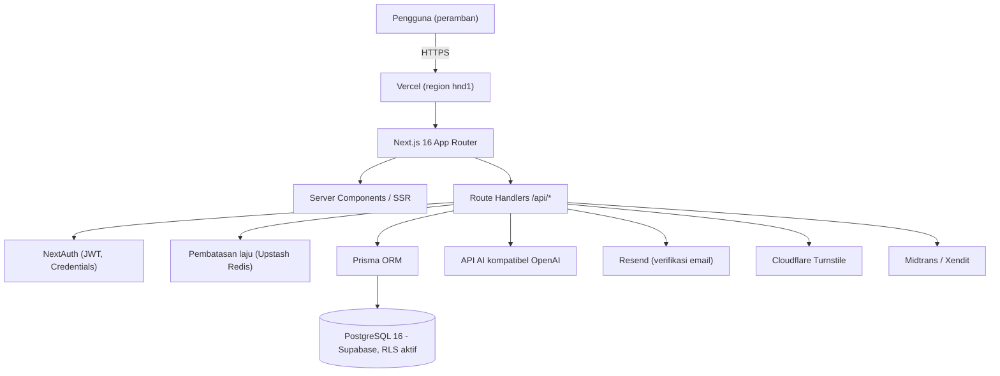

# Tech Stack SOBAT ADI - Draf Bab Skripsi

Dokumen ini merapikan daftar teknologi aplikasi **SOBAT ADI (Astoria Collab)**
menjadi format akademik, siap dipindahkan ke Bab III (Metodologi/Perancangan)
atau Bab IV (Hasil dan Pembahasan). Nomor subbab memakai awalan `3.` -
sesuaikan dengan penomoran naskah.

Versi yang dicantumkan adalah **versi terpasang** (`node_modules`), bukan rentang
`package.json`.

---

## 3.1 Gambaran Umum Arsitektur Sistem

SOBAT ADI dibangun dengan pendekatan **monolit modular berbasis Next.js App
Router**. Seluruh lapisan presentasi, logika bisnis, dan antarmuka pemrograman
aplikasi (API) berada dalam satu basis kode TypeScript, lalu dijalankan sebagai
fungsi serverless pada platform Vercel.

Secara logis sistem dibagi menjadi empat lapisan:

1. **Lapisan presentasi** - React Server Components dan Client Components.
2. **Lapisan aplikasi** - Route Handlers `/api/*` dan Server Actions.
3. **Lapisan data** - Prisma ORM dengan basis data PostgreSQL.
4. **Lapisan layanan eksternal** - penyedia model bahasa (AI), Redis untuk
   pembatasan laju, layanan surel, CAPTCHA, dan payment gateway.

Pemisahan ini memudahkan pengujian: lapisan aplikasi diuji melalui pengujian
integrasi terhadap basis data nyata, sedangkan antarmuka diuji melalui
pengujian end-to-end.

### 3.1.1 Diagram Arsitektur



Versi teks (untuk Word):

```text
Pengguna
   │ HTTPS
   ▼
Vercel (hnd1) ── Next.js 16 App Router
   ├── Server Components / SSR  → antarmuka
   └── Route Handlers /api/*    → logika bisnis
          ├── NextAuth (JWT)            autentikasi & otorisasi
          ├── Upstash Redis             pembatasan laju
          ├── Prisma ORM → PostgreSQL   data persisten (Supabase, RLS)
          ├── API AI kompatibel OpenAI  asisten, kuis, RAG
          ├── Resend                    verifikasi email
          ├── Cloudflare Turnstile      CAPTCHA
          └── Midtrans / Xendit         pembayaran Premium
```

### 3.1.2 Alur Permintaan

1. Peramban meminta halaman; Next.js merender Server Component dan mengambil
   data langsung melalui Prisma pada sisi server.
2. Interaksi dinamis (chat AI, kuis, Kanban) memanggil Route Handler.
3. Setiap Route Handler memeriksa sesi NextAuth, kuota paket, dan pembatasan
   laju sebelum menyentuh basis data.
4. Data ditulis/dibaca melalui Prisma dengan transaksi dan penguncian baris
   bila melibatkan kuota atau poin.
5. Hasil dikembalikan sebagai JSON dan diperbarui di klien melalui TanStack
   Query.

---

## 3.2 Spesifikasi Teknologi

### Tabel 3.1 Teknologi Lapisan Presentasi

| No | Teknologi | Versi | Peran dalam sistem |
|---|---|---|---|
| 1 | React | 19.2.3 | Pustaka antarmuka pengguna |
| 2 | Next.js | 16.4.3 | Kerangka kerja full-stack (App Router, SSR, routing API) |
| 3 | TypeScript | 5.9.3 | Bahasa pemrograman bertipe statis |
| 4 | Tailwind CSS | 4.1.18 | Kerangka kerja utilitas tata letak |
| 5 | shadcn/ui + Radix UI | - | Komponen antarmuka aksesibel (dialog, select, tooltip, dll.) |
| 6 | lucide-react | 0.525.0 | Pustaka ikon |
| 7 | Framer Motion | 12.26.2 | Animasi dan transisi |
| 8 | TanStack Query | 5.90.19 | Manajemen state server dan cache |
| 9 | Zustand | 5.0.10 | Manajemen state klien |
| 10 | React Hook Form + Zod | 7.x / 4.6.7 | Formulir dan validasi skema |
| 11 | Recharts | 2.15.4 | Visualisasi data analitik |
| 12 | dnd-kit | 6.3.1 | Papan Kanban dengan seret-lepas |
| 13 | pdf.js (pdfjs-dist) | 6.4.299 | Penampil dokumen PDF |
| 14 | Sonner | 2.0.7 | Notifikasi ringkas (toast) |

### Tabel 3.2 Teknologi Lapisan Aplikasi dan Data

| No | Teknologi | Versi | Peran dalam sistem |
|---|---|---|---|
| 1 | Next.js Route Handlers | 16.4.3 | 42 endpoint REST internal |
| 2 | Prisma ORM | 6.19.2 | Pemetaan objek-relasional, migrasi, transaksi |
| 3 | PostgreSQL | 16 | Basis data relasional |
| 4 | Supabase | - | Penyedia PostgreSQL terkelola + Row Level Security |
| 5 | NextAuth.js | 4.24.15 | Autentikasi (Credentials, sesi JWT) |
| 6 | bcryptjs | 3.0.3 | Hash kata sandi (cost 12) |
| 7 | Upstash Redis | - | Pembatasan laju terdistribusi |
| 8 | Cloudflare Turnstile | - | CAPTCHA |
| 9 | Resend | - | Pengiriman surel verifikasi |
| 10 | Midtrans Snap / Xendit | - | Payment gateway langganan Premium |
| 11 | API AI kompatibel OpenAI | - | Model bahasa untuk asisten, kuis, dan RAG |

### Tabel 3.3 Perkakas Pengembangan dan Pengujian

| No | Teknologi | Versi | Peran |
|---|---|---|---|
| 1 | Bun | 1.3.x | Manajer paket dan runner skrip |
| 2 | ESLint | 9.39.2 | Analisis statis gaya kode |
| 3 | Vitest | 5.1.0 | Pengujian unit dan integrasi |
| 4 | Testing Library + jsdom | 16.3.3 / 30.x | Pengujian komponen |
| 5 | Playwright | 1.64.1 | Pengujian end-to-end |
| 6 | Docker Compose | - | PostgreSQL lokal (dev dan uji) |
| 7 | GitHub Actions | - | Integrasi berkelanjutan |
| 8 | Vercel | - | Deployment produksi |

---

## 3.3 Justifikasi Pemilihan Teknologi

Tabel berikut dapat dipakai pada subbab "pemilihan teknologi" dengan pola
**kebutuhan → alternatif → keputusan → alasan**.

| Kebutuhan | Alternatif yang dipertimbangkan | Keputusan | Alasan |
|---|---|---|---|
| Kerangka kerja web full-stack | Express + React SPA, Laravel, Next.js | **Next.js** | Satu basis kode untuk antarmuka dan API, dukungan SSR/RSC, deployment terkelola di Vercel |
| Bahasa pemrograman | JavaScript, PHP, TypeScript | **TypeScript** | Kesalahan tipe terdeteksi saat kompilasi; kontrak data API lebih aman |
| Basis data | SQLite, MySQL, PostgreSQL | **PostgreSQL** | Lingkungan serverless Vercel bersifat read-only untuk berkas lokal, sehingga SQLite tidak layak; PostgreSQL mendukung transaksi, constraint, dan RLS |
| Penyedia basis data | Neon, Railway, Supabase | **Supabase** | PostgreSQL terkelola, koneksi pooler untuk serverless, RLS siap pakai |
| ORM | Prisma, Drizzle, raw SQL | **Prisma** | Skema deklaratif, riwayat migrasi, transaksi interaktif, tipe otomatis |
| Autentikasi | Auth0, Clerk, NextAuth | **NextAuth** | Tanpa biaya, terintegrasi App Router, mendukung Credentials dan JWT |
| Validasi masukan | Manual, Yup, Zod | **Zod** | Skema tunggal dipakai di klien dan server; pesan galat terstruktur |
| Pembatasan laju | Middleware memori, Nginx, Upstash | **Upstash Redis** | Lingkungan serverless tidak menyimpan state; Redis memberi hitungan terdistribusi |
| CAPTCHA | reCAPTCHA, hCaptcha, Turnstile | **Turnstile** | Tanpa interaksi pengguna, ramah privasi, gratis |
| Layanan surel | SMTP mandiri, SendGrid, Resend | **Resend** | API sederhana, reputasi pengiriman baik, integrasi domain mudah |
| Model bahasa | Model lokal, OpenAI, OpenRouter | **API kompatibel OpenAI (OpenRouter)** | Tidak memerlukan GPU; antarmuka standar sehingga penyedia dapat diganti tanpa mengubah kode |
| Pembayaran | Transfer manual, Midtrans, Xendit | **Midtrans (utama), Xendit (cadangan)** | Mendukung QRIS, VA, dan e-wallet; sesuai kebutuhan pengguna Indonesia |
| Pengujian | Jest, Vitest | **Vitest + Playwright** | Vitest cepat dan kompatibel ESM/TypeScript; Playwright menguji alur nyata di peramban |

---

## 3.4 Pemetaan Teknologi terhadap Kebutuhan Fungsional

| Kode | Kebutuhan fungsional | Teknologi yang berperan |
|---|---|---|
| F-01 | Registrasi dengan verifikasi email | NextAuth, bcryptjs, Resend, Turnstile, Redis |
| F-02 | Trial Premium 7 hari setelah verifikasi | Prisma, PostgreSQL (status `plan` dan `planExpiresAt`) |
| F-03 | Asisten AI dan RAG atas dokumen pengguna | API AI, embedding, Prisma (`Document`, `Chunk`) |
| F-04 | Kuis otomatis dan penilaian | API AI, Prisma (`QuizQuestion`, `QuizAttempt`) |
| F-05 | Kolaborasi tim: undangan, proyek, Kanban | NextAuth, Prisma (`Team`, `TeamInvite`, `Project`, `Task`), dnd-kit |
| F-06 | Gamifikasi: XP, lencana, papan peringkat | Prisma (transaksi atomik), Recharts |
| F-07 | Analitik tim | Prisma agregasi, Recharts |
| F-08 | Langganan Premium | Midtrans/Xendit, webhook bertanda tangan, Prisma (`Payment`) |
| F-09 | Panel administrasi | NextAuth (role `admin`), Route Handlers `/api/admin/*` |
| F-10 | Kuota AI harian (reset 00.00 WIB) | Redis, Prisma, transaksi dengan penguncian baris |

---

## 3.5 Metrik Implementasi

Angka berikut dapat dipakai pada Bab IV sebagai bukti kuantitatif.

| Metrik | Nilai |
|---|---|
| Baris kode sumber (`src/**/*.ts,tsx`) | ± 15.071 |
| Halaman aplikasi (`page.tsx`) | 11 |
| Endpoint API (`route.ts`) | 42 |
| Komponen antarmuka (`.tsx`) | 63 |
| Model data Prisma | 18 |
| Migrasi basis data | 8 |
| Tabel dengan Row Level Security | 19 |
| Berkas uji unit | 10 |
| Berkas uji integrasi | 7 |
| Berkas uji end-to-end | 8 |

Catatan: jumlah kasus uji terakhir yang tercatat adalah 150 unit, 139
integrasi, dan 13 end-to-end (lihat `MONITORING-LOG.md`).

---

## 3.6 Lingkungan Pengembangan dan Operasional

| Aspek | Lingkungan pengembangan | Lingkungan produksi |
|---|---|---|
| Runtime aplikasi | `next dev` (port 3000) | Vercel, region `hnd1` |
| Basis data | PostgreSQL 16 via Docker (`sobadi-dev-db`, port 5432) | Supabase (pooler transaksi 6543, sesi 5432) |
| Basis data pengujian | `sobadi-test-db` (port 5434, penyimpanan sementara) | - |
| Reverse proxy lokal | Caddy (port 81) | Vercel Edge Network |
| Variabel rahasia | `.env` (tidak di-commit) | Environment Variables Vercel |
| Pembatasan laju | Fallback memori | Redis, `RATE_LIMIT_FAIL_CLOSED=true` |
| Integrasi berkelanjutan | - | GitHub Actions (`ci.yml`) |

---

## 3.7 Batasan dan Asumsi

Bagian ini penting agar pembahasan skripsi tidak melebihkan klaim.

1. **Pencarian semantik belum memakai pgvector.** Vektor embedding disimpan
   sebagai JSON pada kolom `Chunk.embedding` dan kemiripan kosinus dihitung di
   lapisan aplikasi. Untuk korpus kecil hal ini memadai, tetapi tidak skalabel
   untuk jutaan potongan teks.
2. **Model bahasa bersifat pihak ketiga.** Kualitas keluaran bergantung pada
   penyedia; sistem hanya menjamin mekanisme cadangan (fallback) dan validasi
   keluaran, bukan kebenaran matematis jawaban.
3. **Pembayaran bergantung pada persetujuan penyedia.** Kanal pembayaran aktif
   setelah business review Midtrans disetujui; selama belum, aktivasi Premium
   dilakukan manual oleh administrator.
4. **Row Level Security bersifat pertahanan berlapis.** Aplikasi tetap
   mengandalkan pemeriksaan sesi dan kepemilikan data di lapisan API; RLS
   mencegah akses langsung ke basis data.
5. **Pengujian beban belum dilakukan.** Metrik kinerja yang dilaporkan terbatas
   pada pengujian fungsional dan end-to-end.

---

## 3.8 Cara Mengutip Dokumen Ini

Bila diperlukan pada daftar pustaka internal:

> Ardiani, L. A. (2026). *SOBAT ADI: Dokumentasi Tech Stack untuk Skripsi*.
> Dokumentasi teknis, Universitas Terbuka.

Sesuaikan nama, tahun, dan institusi dengan data naskah Anda.
