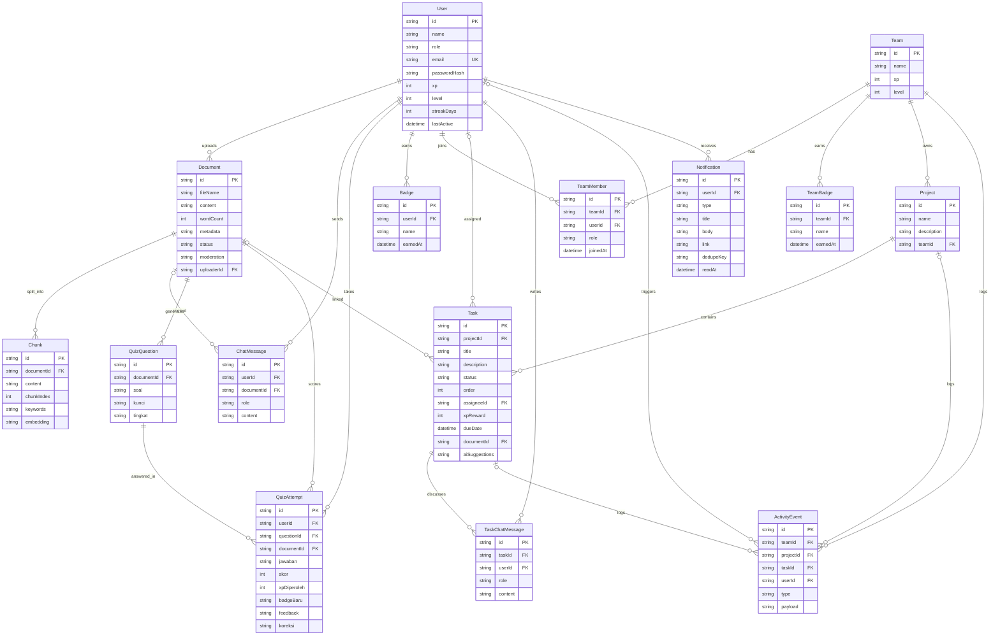

# Verifikasi & Validasi Dokumen UML/ERD terhadap Implementasi SOBAT ADI

- **Dokumen yang diverifikasi:** `UML_ERD.docx` (4 halaman, 4 gambar: Use Case, Activity, Sequence, ERD + narasi)
- **Tanggal verifikasi:** 1 November 2026
- **Basis kode:** commit `b1f91d8` (`main`)
- **Sumber kebenaran:** `prisma/schema.prisma`, 25 route di `src/app/api/**`, komponen di `src/components/astoria/**`, dan helper di `src/lib/**`
- **Metode:** pembacaan teks + keempat gambar diagram, lalu penelusuran kode per use case, alur, entitas, field, relasi, dan aturan akses. Status setiap temuan diberi bukti file/baris.

## Legenda status

| Status | Arti |
|---|---|
| **Sesuai** | Perilaku/entitas ada dan digambarkan benar |
| **Sebagian** | Ada, tetapi nama, aktor, cakupan, field, atau relasinya berbeda |
| **Tidak sesuai** | Tidak diimplementasikan, atau bertentangan dengan kode |
| **Belum tercatat** | Ada di aplikasi, tetapi tidak ada di dokumen |

---

## 0. Ringkasan eksekutif

| Artefak | Verdict | Dasar |
|---|---|---|
| **Use Case** | **Perlu dilengkapi** | 15 dari 18 use case sesuai, 2 sebagian, 1 tidak ada di aplikasi; 10 use case yang benar-benar ada belum tercatat; 1 relasi `«include»` keliru |
| **Activity** | **Perlu dikoreksi** | 11 dari 12 langkah naratif akurat, tetapi 6 titik pada gambar bertentangan dengan kode (pemisahan peran, penambahan anggota, hak tugas, laporan tugas, dll.) |
| **Sequence** | **Perlu dikoreksi** | 5 dari 10 alur akurat; 5 sebagian; 4 alur penting (registrasi, pembuatan proyek, moderasi admin, notifikasi tenggat) tidak ada |
| **ERD** | **Perlu revisi besar** | Dari 12 entitas: 9 ada (sebagian field berbeda), **3 tidak ada di kode**; **6 model kode tidak ada di ERD**; tipe ID, enum, dan kardinalitas berbeda |
| **Narasi teks** | **Perlu disinkronkan** | Mengikuti ERD lama, sehingga ikut menyebut tabel yang tidak ada |

**Kesimpulan:** dokumen ini **valid sebagai rancangan konseptual tingkat tinggi**, tetapi **belum valid sebagai dokumentasi implementasi**—terutama ERD. Jika dipakai untuk bab perancangan skripsi/laporan, ERD dan beberapa alur harus direvisi agar tidak menimbulkan pertanyaan saat sidang atau saat penguji membandingkan dengan aplikasi.

**5 temuan paling kritis:**

1. **“Laporan Tugas” dan use case “Melaporkan Hasil Tugas” tidak ada sama sekali di kode.** Tidak ada model, route, maupun teks “laporan/report” di `src`. Penyelesaian tugas hanya berupa perpindahan status Kanban ke `done`.
2. **Entitas “Kuis” tidak ada.** Kode menyimpan `QuizQuestion` langsung pada `Document`, dan `QuizAttempt` per soal. Tidak ada tabel sesi kuis.
3. **“Progres Pengguna” bukan tabel.** XP, level, dan streak disimpan langsung di `User` (`prisma/schema.prisma:18-20`).
4. **Hierarki tugas salah.** ERD menghubungkan `Tugas → Tim`, sedangkan kode: `Team → Project → Task`. **Model `Project` tidak ada di ERD.**
5. **Enam model inti hilang dari ERD:** `Project`, `Chunk` (RAG), `ActivityEvent` (feed/analitik), `Badge`, `TeamBadge`, dan `TaskChatMessage` (Mentor AI per tugas).

---

## 1. Use Case Diagram

### 1.1 Verifikasi use case yang digambar

| # | Use case (dokumen) | Status | Bukti / catatan |
|---|---|---|---|
| 1 | Melihat Beranda | **Sesuai** | `HomeView` memuat `/api/greeting` + `/api/profile` (`home-view.tsx:66`) |
| 2 | Menggunakan Mentor AI | **Sesuai** | `POST /api/chat` + `ChatView`; RAG + riwayat 6 pesan (`chat/route.ts:88-118`) |
| 3 | Mengelola Tugas | **Sesuai** | Kanban drag-and-drop, tambah/hapus tugas (`kanban-board.tsx`, `tasks/[taskId]/route.ts`) |
| 4 | **Melaporkan Hasil Tugas** | **Tidak sesuai** | Tidak ada model/route/field laporan. Satu-satunya jejak adalah event `task_completed` (`tasks/[taskId]/route.ts:61-79`) yang hanya mencatat judul, bukan isi laporan |
| 5 | Melihat Analitik Tim | **Sesuai** | `/collab/analytics` + `AnalyticsDashboard` (`analytics-dashboard.tsx`) |
| 6 | Melihat Notifikasi | **Sesuai** | `NotificationBell` + `/api/collab/notifications` |
| 7 | Memproses Dokumen | **Sesuai** | Chunking + embedding + AI Document Processor + Moderator (`documents/route.ts:96-179`) |
| 8 | Mengunggah Modul | **Sesuai** | `UploadView` + `POST /api/documents` |
| 9 | Mengerjakan Kuis | **Sesuai** | `QuizView` + `POST /api/quiz/submit` |
| 10 | Melihat Nilai dan XP | **Sesuai** | Respons submit memuat `skor`, `xpDiperoleh`, `feedback`, `badgeBaru` (`quiz/submit/route.ts:167-180`) |
| 11 | Menambahkan Anggota | **Sebagian** | Ada, tetapi **hanya owner** dan dilakukan **setelah** tim dibuat (`members/route.ts:21-27`), bukan bagian wajib dari “Membuat Tim” |
| 12 | Membuat Tim | **Sesuai** | `POST /api/collab/teams`; pembuat otomatis menjadi `owner` (`teams/route.ts:41-47`) |
| 13 | Login | **Sesuai** | NextAuth Credentials + bcrypt (`lib/auth.ts:13-38`) |
| 14 | Logout | **Sesuai** | `signOut` di header (`page.tsx:142-150`) |
| 15 | Melihat Dashboard Admin | **Sebagian** | Panel admin ada sebagai **tab di halaman yang sama**, bukan halaman terpisah; admin login tetap diarahkan ke Beranda (`login-form.tsx:31`) |
| 16 | Manajemen dan Moderasi Dokumen | **Sesuai** | Aktifkan/Review/Tolak/Hapus (`admin-view.tsx:94-126`; `admin/decision/route.ts`) |
| 17 | Melihat Ringkasan Platform | **Sesuai** | Statistik + status breakdown (`admin-view.tsx:152-184, 311-375`) |
| 18 | Melihat Insight AI | **Sesuai** | `ANALYTICS_SUMMARIZER` via `/api/admin/analytics` |

**Angka:** 15 sesuai, 2 sebagian (Menambahkan Anggota, Dashboard Admin), 1 tidak sesuai (Melaporkan Hasil Tugas) dari 18 yang digambar.

### 1.2 Use case yang ada di aplikasi, tetapi belum tercatat

| # | Use case | Bukti |
|---|---|---|
| 1 | **Daftar / Membuat Akun** | `/register`, `POST /api/auth/register` (`register/route.ts`) |
| 2 | **Membuat Proyek** | `CreateProjectDialog`, `POST /api/collab/projects` |
| 3 | **Melihat Leaderboard Tim** | `TeamLeaderboard`, `GET /api/collab/teams/leaderboard` |
| 4 | **Melihat Lencana Individu** | `Badge`, `/api/profile` (`profile/route.ts:50-54`), katalog di Beranda |
| 5 | **Melihat Lencana Tim** | `TeamBadge`, `TeamBadges`, `collab-badges.ts` |
| 6 | **Melihat Activity Feed Tim** | `ActivityFeed`, `GET /api/collab/projects/[projectId]/activity` |
| 7 | **Menggunakan Mentor AI per Tugas** | `TaskMentorChat`, `POST /api/collab/tasks/[taskId]/mentor` |
| 8 | **Menghapus Modul/Dokumen** | `DELETE /api/documents/[id]` (`documents/[id]/route.ts:51-63`) |
| 9 | **Menandai Notifikasi Dibaca** | `POST /api/collab/notifications` + tombol di `NotificationBell` |
| 10 | **Menugaskan Tugas ke Anggota** | API mendukung `assigneeId` (`tasks/route.ts:25,38`), tetapi **belum ada kontrol di UI** |

> Catatan: “Menugaskan Tugas” bisa dianggap bagian dari “Mengelola Tugas”, tetapi karena ERD dan narasi menyebut penetapan tugas, sebaiknya eksplisit.

### 1.3 Masalah aktor dan relasi

1. **`Admin` digambarkan sebagai aktor eksklusif.** Di kode, admin adalah `User` dengan `role = "admin"` dan tetap bisa memakai fitur mahasiswa (Beranda, Mentor AI, Collab). Tidak ada generalisasi aktor `Admin → Pengguna`.
2. **`«include» Membuat Tim → Menambahkan Anggota` salah secara semantik.** Membuat tim hanya membutuhkan nama; penambahan anggota bersifat opsional, terpisah, dan hanya boleh dilakukan owner. Seharusnya relasi terpisah, atau `«extend»` bila ingin menunjukkan opsionalitas.
3. **`«include» Mengerjakan Kuis → Melihat Nilai dan XP` dapat diterima** karena nilai/XP langsung ditampilkan setelah submit, tetapi lebih tepat sebagai *postcondition* atau `«extend»` bila ingin menekankan bahwa melihat detail nilai bersifat opsional.
4. **`«include» Mengunggah Modul → Memproses Dokumen` sudah benar** karena pemrosesan AI otomatis dijalankan.
5. **Tidak ada use case untuk registrasi** padahal halaman `/register` adalah pintu masuk utama pengguna baru.

---

## 2. Activity Diagram

### 2.1 Verifikasi alur

| Bagian alur (dokumen) | Status | Bukti |
|---|---|---|
| Buka aplikasi → halaman login | **Sesuai** | `page.tsx:46-48` redirect ke `/login` bila `unauthenticated` |
| Input email/password → validasi akun | **Sesuai** | `auth.ts:20-36` |
| Akun tidak valid → kembali ke login | **Sesuai** | Toast error, tetap di `/login` (`login-form.tsx:27-29`) |
| Sistem memeriksa peran | **Sebagian** | Role disimpan di sesi (`auth.ts:41-52`), tetapi tidak dipakai untuk memilih halaman tujuan |
| **Admin → halaman Admin** | **Tidak sesuai** | Semua peran diarahkan ke `/` (`login-form.tsx:31`). Admin melihat **tab** Admin (`page.tsx:98,161`), bukan halaman dashboard terpisah |
| Pengguna → Beranda | **Sesuai** | `/` merender `HomeView` |
| Pilih fitur → sistem memproses | **Sesuai** | View SPA: Beranda/Mentor/Unggah/Kuis + `/collab` |
| Berpindah fitur | **Sesuai** | Navigasi tab + tautan Collab |
| Logout → sesi berakhir | **Sesuai** | `signOut({ callbackUrl: "/login" })` |
| **“Menambahkan anggota secara otomatis” setelah membuat tim** | **Tidak sesuai** | `POST /api/collab/teams` hanya menambah pembuat sebagai `owner` (`teams/route.ts:41-47`); anggota lain ditambahkan manual lewat pencarian nama (owner-only) |
| **“Memilih pengguna” sebelum membuat tim** | **Tidak sesuai** | Dialog “Buat Tim” hanya berisi nama tim (`create-team-dialog.tsx:62-71`) |
| **“Pembuat tim membuat dan menetapkan tugas”** | **Sebagian** | Semua anggota tim boleh membuat tugas (`tasks/route.ts:21`), bukan hanya pembuat. Penetapan assignee ada di API, tetapi tidak ada kontrol UI |
| **“Anggota melaporkan hasil”** | **Tidak sesuai** | Tidak ada fitur/laporan; penyelesaian hanya memindahkan kartu ke `done` |
| **“Pembuat tim memperbarui status tugas”** | **Tidak sesuai** | Semua anggota boleh memindahkan status (`tasks/[taskId]/route.ts:25`) |
| Memilih modul untuk Mentor AI | **Sebagian** | Daftar berisi dokumen milik sendiri **dan dokumen `approved`** milik orang lain (`documents/route.ts:50`; filter `rejected` di `chat-view.tsx:58-60`) |
| AI membuat lima soal esai | **Sesuai** | `quiz.soal.slice(0, 5)` (`quiz/generate/route.ts:67`) — maksimal 5, jumlah aktual mengikuti respons AI |
| AI menilai jawaban | **Sesuai** | `QUIZ_EVALUATOR_PROMPT` (`quiz/submit/route.ts:84-104`) |
| Menampilkan nilai, umpan balik, XP | **Sesuai** | `quiz/submit/route.ts:167-180` |
| Admin: manajemen/moderasi dokumen | **Sesuai** | `AdminView` + `/api/admin/decision` |
| Admin: ringkasan platform & Insight AI | **Sesuai** | `/api/admin/analytics` |

### 2.2 Kekurangan alur

- **Registrasi akun** tidak ada di alur, padahal login mengasumsikan akun sudah dibuat.
- **Pembuatan proyek** tidak ada, padahal tugas tidak bisa dibuat tanpa proyek (`Task.projectId` wajib).
- **Alur notifikasi tenggat** (`task_due_soon`, `task_overdue`) tidak tergambar; notifikasi ini dibuat saat daftar notifikasi dibuka (`collab-notify.ts:50-74`).
- **Alur badge & leaderboard** tidak tergambar, padahal keduanya memicu notifikasi/XP.
- **Alur hapus dokumen** dan **hapus tugas** tidak tergambar.
- Diagram tidak memakai *swimlane* sehingga batas tanggung jawab (pengguna vs sistem vs admin) tidak terlihat, padahal ada klaim peran yang perlu diverifikasi.

---

## 3. Sequence Diagram

### 3.1 Verifikasi per alur

| Alur (dokumen) | Status | Bukti / catatan |
|---|---|---|
| **Login** — kirim kredensial → periksa akun & peran | **Sebagian** | Pemeriksaan akun/peran benar (`auth.ts`), tetapi UI **tidak** mengarahkan admin ke dashboard admin |
| **Beranda** — ambil info dashboard sesuai akun | **Sesuai** | `/api/greeting` + `/api/profile` berbasis sesi |
| **Unggah Modul** — unggah → proses AI → simpan | **Sesuai** | `documents/route.ts`; diagram tidak menampilkan chunking + embedding, tetapi tidak salah |
| **Mentor AI** — pilih modul → tanya → jawaban dari modul | **Sebagian** | Bisa memakai dokumen `approved` milik pengguna lain, bukan hanya “modul milik pengguna” (`chat/route.ts:85`, `canUseDocument`) |
| **Kuis** — minta kuis → 5 soal → jawab → nilai/feedback/XP | **Sesuai** | `quiz/generate` + `quiz/submit` |
| **Kolaborasi Tim** — buat tim & pilih anggota → simpan → notifikasi | **Sebagian** | Pembuatan tim tidak menerima daftar anggota; anggota ditambahkan setelahnya, owner-only. Notifikasi memang dikirim (`members/route.ts:62-76`) |
| **Pengelolaan Tugas** — pembuat tim membuat/menetapkan → anggota mengerjakan/melaporkan → pembuat memperbarui status | **Sebagian** | Tugas dibuat/dipindahkan oleh **semua anggota**; **tidak ada laporan hasil**; assignee hanya via API |
| **Analitik & Notifikasi** — lihat ringkasan & notifikasi | **Sesuai** | `/api/collab/analytics`, `/api/collab/notifications` |
| **Admin** — akses info platform & manajemen/moderasi | **Sebagian** | Statistik & insight ada; **keputusan moderasi tidak digambarkan** di sequence |
| **Logout** — akhiri sesi | **Sesuai** | `signOut` |
| **Registrasi** | **Belum tercatat** | `/api/auth/register` + `/register` |
| **Pembuatan proyek** | **Belum tercatat** | `POST /api/collab/projects` |
| **Moderasi admin (keputusan)** | **Belum tercatat** | `POST /api/admin/decision` |
| **Notifikasi deadline** | **Belum tercatat** | `scanDeadlines` saat GET notifikasi |

### 3.2 Catatan arsitektur

- Lifeline **“Layanan Notifikasi”** tidak merepresentasikan layanan eksternal. Notifikasi disimpan di tabel `Notification` dan dibaca lewat API; tidak ada email/push/queue. Jika maksudnya subsistem internal, beri nama “Modul Notifikasi (in-app)”.
- Lifeline **“Layanan AI”** tepat: satu klien OpenAI-compatible (`lib/ai.ts`) untuk chat, embedding, kuis, moderasi, dan insight.
- Diagram tidak menunjukkan **transaksi/urutan penyimpanan** yang sebenarnya pada unggah: `Document` → `Chunk` → embedding → metadata AI → moderasi → update status. Ini penting karena status `pending/approved/rejected` ditentukan setelah AI moderasi (`documents/route.ts:162-179`).
- Alur login menampilkan “mengirim hasil login” ke UI, tetapi tidak menunjukkan penyimpanan sesi JWT/ cookie. Tidak wajib, tetapi bisa ditambahkan.

---

## 4. ERD

### 4.1 Inventaris entitas: dokumen vs kode

| Entitas di ERD | Padanan di `schema.prisma` | Status | Catatan |
|---|---|---|---|
| Pengguna | `User` | **Sebagian** | ID `String cuid`, bukan `INT`; `email`/`passwordHash` nullable; `role` String, bukan enum; XP/level/streak **inline** |
| Modul | `Document` | **Sebagian** | Field berbeda: `fileName`, `content`, `wordCount`, `metadata`, `moderation`, `status`, `uploaderId` |
| Pesan Mentor | `ChatMessage` | **Sebagian** | `role`, `content`; `documentId` **nullable**; tidak ada kolom `referensi_bagian` |
| **Kuis** | — | **Tidak ada** | Tidak ada tabel sesi kuis; `QuizQuestion` langsung milik `Document` |
| Pertanyaan Kuis | `QuizQuestion` | **Sebagian** | Punya `kunci`, `tingkat`, `createdAt`; induknya `Document`, bukan `Kuis` |
| Jawaban Kuis | `QuizAttempt` | **Sebagian** | `skor` Int (bukan DECIMAL), ada `xpDiperoleh`, `badgeBaru`, `feedback`, `koreksi`, `documentId` |
| **Progres Pengguna** | — (menyatu di `User`) | **Tidak ada** | `xp`, `level`, `streakDays` ada di `User` |
| Tim | `Team` | **Sebagian** | Tidak ada `id_pembuat`; pembuat = `TeamMember.role = "owner"` |
| Anggota Tim | `TeamMember` | **Sebagian** | Ada `id` sendiri + `role` (`owner/member`); unique `(teamId,userId)` |
| Tugas | `Task` | **Sebagian** | Milik `Project`, bukan `Team`; tidak ada `id_pembuat`; `assigneeId` nullable; ada `order`, `xpReward`, `documentId`, `aiSuggestions` |
| **Laporan Tugas** | — | **Tidak ada** | Tidak ada model/route/field laporan |
| Notifikasi | `Notification` | **Sebagian** | Hanya penerima (`userId`); tidak ada `id_pembuat`/`id_tim`; ada `type`, `title`, `body`, `link`, `dedupeKey`, `readAt` |

**Entity-level:** 9 dari 12 entitas ERD punya padanan (75%), tetapi 3 tidak ada. Dari 15 model kode, hanya 9 terwakili (60%).

### 4.2 Model kode yang tidak ada di ERD

| Model | Fungsi | Dampak jika tidak ada di ERD |
|---|---|---|
| **Project** | Wadah tugas per tim (`schema.prisma:93-103`) | Hierarki `Tim → Tugas` di ERD salah; pembuatan proyek tidak terlihat |
| **Chunk** | Potongan dokumen + `keywords` + `embedding` untuk RAG (`:176-184`) | Fitur inti (RAG) tidak terlihat di struktur data |
| **TaskChatMessage** | Riwayat Mentor AI per tugas (`:128-137`) | Fitur “Mentor AI per tugas” tidak terlihat |
| **ActivityEvent** | Feed aktivitas + dasar analitik/badge (`:140-153`) | Analitik tim, activity feed, dan audit trail tidak terlihat |
| **Badge** | Lencana individu (`:229-237`) | Gamifikasi individu tidak terlihat |
| **TeamBadge** | Lencana tim (`:52-60`) | Gamifikasi tim & leaderboard tidak terlihat |

### 4.3 Field yang berbeda atau hilang

| Entitas | Dokumen | Implementasi | Dampak |
|---|---|---|---|
| Pengguna | `oid_pengguna INT`, `kata_sandi VARCHAR`, `peran ENUM` | `id String cuid`, `passwordHash String?`, `role String` default `mahasiswa` | Tipe & nullability berbeda; enum tidak ditegakkan DB |
| Pengguna | — | `xp`, `level`, `streakDays`, `lastActive`, `createdAt`, `updatedAt` | Progres tidak terlihat di entitas Pengguna |
| Modul | `nama_modul`, `isi_modul`, `status_moderasi`, `tanggal_unggah` | `fileName`, `content`, `wordCount`, `metadata` (JSON), `moderation` (JSON), `status`, `createdAt`, `updatedAt` | Hasil AI (metadata & moderasi) tidak terwakili |
| Pesan Mentor | `jenis_pengirim`, `isi_pesan`, `referensi_bagian`, `waktu_kirim` | `role`, `content`, `createdAt`; **tanpa** `referensi_bagian` | Sitasi hanya ada di dalam teks jawaban, tidak terstruktur |
| Pertanyaan Kuis | `isi_pertanyaan` | `soal`, `kunci`, `tingkat` | Kunci jawaban & tingkat kesulitan tidak terlihat |
| Jawaban Kuis | `nilai DECIMAL`, `umpan_balik`, `xp_diperoleh` | `skor Int`, `feedback`, `xpDiperoleh`, `badgeBaru`, `koreksi`, `documentId` | Badge & koreksi tidak terlihat |
| Tim | `id_pembuat`, `total_xp_tim`, `level_tim` | `name`, `xp`, `level`; tanpa `id_pembuat` | Kepemilikan tim tidak terlihat |
| Anggota Tim | `(id_tim, id_pengguna) PK`, `tanggal_bergabung` | `id` PK + unique `(teamId,userId)` + `role` | Peran owner/member (dasar hak akses) tidak terlihat |
| Tugas | `id_tim`, `id_pembuat`, `id_penerima_tugas`, `tenggat_waktu` | `projectId`, `assigneeId?`, `dueDate?`, `order`, `xpReward`, `documentId?`, `aiSuggestions` | Tidak ada pembuat; assignee & tenggat opsional; relasi ke proyek/dokumen hilang |
| Notifikasi | `id_pembuat`, `id_tim`, `isi_notifikasi`, `status_dibaca`, `waktu_dibuat` | `userId`, `type`, `title`, `body?`, `link?`, `dedupeKey?`, `readAt?`, `createdAt` | Pengirim/tim tidak tersimpan; status dibaca berupa timestamp |

### 4.4 Kardinalitas yang perlu dikoreksi

| Relasi di dokumen | Implementasi sebenarnya |
|---|---|
| Tim 1—N Tugas | **Tim 1—N Project 1—N Task** (tidak langsung) |
| Pengguna 1—N Tugas (pembuat) | **Tidak ada** kolom pembuat di `Task`; pelaku dicatat di `ActivityEvent.userId` |
| Pengguna 1—N Tugas (penerima) | `Task.assigneeId` **nullable** (bisa belum ditugaskan) |
| Modul 1—N Kuis | Tidak ada `Kuis`; `Document 1—N QuizQuestion` |
| Kuis 1—N Pertanyaan | Tidak ada; `QuizQuestion` langsung milik `Document` |
| Pengguna 1—1 Progres | Tidak ada relasi; field menyatu di `User` |
| Tim 1—N Notifikasi | Tidak ada `teamId` di `Notification`; hanya `link` |
| Pengguna 1—N Notifikasi (pembuat) | Tidak ada; notifikasi hanya punya penerima |
| Tugas 1—N Laporan | Tidak ada |
| Modul 1—N Pesan Mentor | `ChatMessage.documentId` **nullable** (opsional) |
| Modul 1—N Tugas | Ada `Task.documentId?` (opsional) — tidak digambar |

Relasi yang **hilang** dari ERD: `User—Badge`, `Team—TeamBadge`, `User/Team/Project/Task—ActivityEvent`, `Task—TaskChatMessage`, `Document—Chunk`, `Document—Task`, `Document—QuizAttempt`.

### 4.5 Tipe data, constraint, dan integritas

1. **ID:** dokumen memakai `INT`; implementasi memakai `String @id @default(cuid())` di semua model.
2. **Enum:** `peran` di dokumen berupa ENUM, sedangkan di implementasi `role` adalah `String` dengan nilai `mahasiswa`/`admin`; `status_tugas` di dokumen sudah VARCHAR, di kode juga `String` dengan nilai `todo/in_progress/review/done`. Validasi hanya di kode (`validation.ts`).
3. **Angka:** `nilai DECIMAL` → `skor Int` (0–100, di-clamp).
4. **Boolean:** `status_dibaca BOOLEAN` → `readAt DateTime?` (lebih informatif).
5. **Nullable:** `User.email`, `User.passwordHash`, `ChatMessage.documentId`, `Task.assigneeId`, `Task.dueDate`, `Notification.body/link/readAt`.
6. **Unique/index tidak tergambar:** `User.email`, `TeamMember(teamId,userId)`, `Badge(userId,name)`, `TeamBadge(teamId,name)`, `Notification(userId,dedupeKey)`, index notifikasi.
7. **Cascade tidak tergambar:** menghapus `Document` menghapus `Chunk`, `ChatMessage`, `QuizQuestion`, `QuizAttempt`; menghapus `Team` menghapus `Project`, `Task`, `TeamMember`, `ActivityEvent`, `TeamBadge`; `Task.assignee` → `SetNull`.
8. **Timestamp:** hampir semua model punya `createdAt`/`updatedAt`; ERD hanya menampilkan beberapa tanggal.

### 4.6 Penilaian ERD

| Aspek | Nilai | Alasan |
|---|---|---|
| Cakupan entitas | **60%** | 9 dari 15 model kode terwakili |
| Ketepatan entitas | **75%** | 3 dari 12 entitas dokumen tidak ada |
| Ketepatan field | **≈50%** | Banyak field hilang/berbeda, terutama JSON AI, kunci kuis, role anggota |
| Ketepatan relasi | **≈50%** | Hierarki tim–proyek–tugas salah; 7+ relasi hilang |
| Kesiapan sebagai dokumentasi implementasi | **Belum** | Perlu revisi besar |

---

## 5. Verifikasi narasi teks

| Pernyataan dokumen | Status | Koreksi |
|---|---|---|
| “Pengguna menjadi entitas utama yang menyimpan data akun Admin dan Pengguna” | **Sesuai** | Role `mahasiswa`/`admin` ada di `User` |
| “Modul menyimpan dokumen pembelajaran yang diunggah pengguna” | **Sesuai** | `Document` |
| “Pesan Mentor menyimpan interaksi pengguna dan Mentor AI” | **Sesuai** | `ChatMessage` |
| “Kuis menyimpan data kuis yang dibuat berdasarkan modul” | **Tidak sesuai** | Tidak ada tabel `Kuis`; soal langsung terkait `Document` |
| “Pertanyaan Kuis menyimpan pertanyaan dalam kuis” | **Sebagian** | Pertanyaan terkait dokumen, bukan kuis |
| “Jawaban Kuis menyimpan jawaban dan hasil evaluasi” | **Sesuai** | `QuizAttempt` |
| “Progres Pengguna menyimpan total XP, level, dan streak” | **Tidak sesuai** | Menyatu di `User` |
| “Tim menyimpan informasi kelompok belajar” | **Sesuai** | `Team` |
| “Anggota Tim mencatat pengguna yang tergabung” | **Sesuai** | `TeamMember` + `role` |
| “Tugas menyimpan informasi tugas yang diberikan kepada anggota tim” | **Sebagian** | Tugas milik **proyek**, bukan tim; assignee opsional |
| “Laporan Tugas menyimpan laporan hasil pengerjaan tugas” | **Tidak sesuai** | Tidak ada |
| “Notifikasi menyimpan pemberitahuan yang dikirimkan kepada pengguna” | **Sesuai** | `Notification` |

---

## 6. Daftar temuan prioritas

### P0 — harus diperbaiki sebelum dokumen dijadikan acuan implementasi

1. **Hapus atau implementasikan** use case “Melaporkan Hasil Tugas” + entitas “Laporan Tugas”.
2. **Ganti entitas “Kuis”** menjadi relasi `Document 1—N QuizQuestion` (atau tambahkan tabel `Quiz` bila memang ingin sesi kuis).
3. **Hapus “Progres Pengguna”** sebagai tabel; pindahkan `xp`, `level`, `streak` ke `Pengguna` (atau nyatakan sebagai *view*/agregat).
4. **Tambahkan `Project`** dan ubah `Tugas.id_tim` → `Tugas.id_proyek`.
5. **Tambahkan `Chunk`, `Badge`, `TeamBadge`, `ActivityEvent`, `TaskChatMessage`**.
6. **Perbaiki `Notifikasi`**: hanya penerima; tambahkan `type/title/body/link/read_at`, hapus `id_pembuat`/`id_tim` (kecuali fitur itu akan dibuat).

### P1 — koreksi perilaku dan kelengkapan

7. Perbaiki alur login: semua peran ke Beranda; admin melihat tab Admin (bukan halaman terpisah).
8. Pisahkan “Membuat Tim” dan “Menambahkan Anggota”; tandai owner-only dan opsional.
9. Perbaiki klaim hak tugas: semua anggota dapat membuat/memindahkan tugas; hapus klaim “pembuat tim” kecuali akan dibatasi di kode.
10. Tambahkan use case: registrasi, membuat proyek, leaderboard, lencana, activity feed, Mentor AI per tugas, hapus modul, tandai notifikasi dibaca.
11. Tambahkan alur moderasi admin dan registrasi ke sequence diagram.
12. Perjelas bahwa Mentor AI dapat memakai dokumen `approved` milik pengguna lain.

### P2 — kualitas dokumentasi

13. Samakan tipe ID (`String cuid`), enum vs String, dan nullability.
14. Tambahkan unique constraint, index, cascade, dan timestamp yang relevan.
15. Tambahkan tabel pemetaan nama Indonesia ↔ nama model Prisma.
16. Tambahkan catatan bahwa `ActivityEvent` adalah log aktivitas, **bukan** laporan tugas.

---

## 7. ERD revisi (sesuai implementasi)

> Gunakan diagram ini sebagai pengganti ERD pada dokumen. Atribut ditampilkan seperlunya (PK/FK dan field domain utama); detail lengkap ada di `prisma/schema.prisma`.



**Catatan pemetaan:** `Pengguna` = `User`; `Modul` = `Document`; `Pesan Mentor` = `ChatMessage`; `Pertanyaan Kuis` = `QuizQuestion`; `Jawaban Kuis` = `QuizAttempt`; `Tim` = `Team`; `Anggota Tim` = `TeamMember`; `Tugas` = `Task`; `Notifikasi` = `Notification`. Entitas tanpa padanan: `Kuis`, `Progres Pengguna`, `Laporan Tugas`.

---

## 8. Daftar use case revisi

**Aktor:** Pengguna (mahasiswa) dan Admin. Admin mewarisi seluruh use case Pengguna dan menambah use case administrasi.

| Kelompok | Use case |
|---|---|
| Autentikasi | Daftar Akun, Login, Logout |
| Pembelajaran | Melihat Beranda, Unggah Modul (**include** Memproses Dokumen), Menggunakan Mentor AI, Mengerjakan Kuis (**include** Melihat Nilai & XP), Melihat Lencana, Hapus Modul |
| Kolaborasi | Membuat Tim, Menambah Anggota (**extend**, owner), Mengeluarkan Anggota (**extend**, owner), Membuat Proyek, Mengelola Tugas (buat/pindah/tugaskan/hapus), Mentor AI per Tugas, Melihat Analitik Tim, Melihat Leaderboard, Melihat Activity Feed, Melihat Notifikasi (**include** Menandai Dibaca) |
| Admin | Dashboard Admin, Moderasi Dokumen (aktifkan/review/tolak/hapus), Ringkasan Platform, Insight AI |

Relasi:
- `Mengunggah Modul ..> Memproses Dokumen : «include»`
- `Mengerjakan Kuis ..> Melihat Nilai dan XP : «include»`
- `Menambah Anggota ..> Membuat Tim : «extend»` (opsional, owner)
- `Mengeluarkan Anggota ..> Membuat Tim : «extend»` (opsional, owner)
- `Admin --|> Pengguna : generalization`

---

## 9. Sequence revisi ringkas

```mermaid
sequenceDiagram
    actor U as Pengguna/Admin
    participant UI as Antarmuka
    participant S as Sistem
    participant DB as Database
    participant AI as Layanan AI

    Note over U,AI: Registrasi & Login
    U->>UI: Daftar (nama, email, password)
    UI->>S: POST /api/auth/register
    S->>DB: cek email + simpan hash bcrypt
    DB-->>S: user
    S-->>UI: akun dibuat
    U->>UI: Login
    UI->>S: POST kredensial
    S->>DB: cari user + verifikasi password
    DB-->>S: user + role
    S-->>UI: sesi JWT
    UI-->>U: redirect "/" (Beranda); tab Admin muncul bila role admin

    Note over U,AI: Kolaborasi (owner)
    U->>UI: Buat tim (nama)
    UI->>S: POST /api/collab/teams
    S->>DB: Team + TeamMember(role=owner)
    U->>UI: Tambah anggota (cari nama)
    UI->>S: POST /api/collab/teams/{id}/members
    S->>DB: TeamMember(role=member)
    S->>DB: Notification(member_added)
    S-->>U: anggota ditambahkan

    Note over U,AI: Proyek & tugas (semua anggota)
    U->>UI: Buat proyek
    UI->>S: POST /api/collab/projects
    S->>DB: Project
    U->>UI: Buat/pindah tugas
    UI->>S: POST/PATCH task
    S->>DB: Task + ActivityEvent
    S->>DB: Team.xp / TeamBadge / Notification

    Note over U,AI: Moderasi admin
    U->>UI: Aktifkan/Tolak dokumen
    UI->>S: POST /api/admin/decision
    S->>DB: Document.status
```

---

## 10. Kesimpulan

1. **Use case dan activity diagram** secara umum menggambarkan produk dengan benar, tetapi mengandung **empat klaim perilaku yang tidak sesuai** dan **belum memuat 10 use case** yang nyata dipakai.
2. **Sequence diagram** benar pada arsitektur besar (UI–sistem–DB–AI), tetapi **tidak menunjukkan registrasi, pembuatan proyek, dan moderasi admin**, serta salah menggambarkan alur tim dan tugas.
3. **ERD adalah bagian yang paling perlu diperbaiki.** Dokumen menggambarkan 12 entitas, sedangkan implementasi memiliki 15 model. Tiga entitas dokumen tidak ada, enam model kode tidak tercatat, dan sebagian besar field/kardinalitas berbeda. ERD saat ini **belum dapat dipakai sebagai dokumentasi struktur basis data aplikasi**.
4. **Rekomendasi utama:** ganti ERD dengan versi pada Bagian 7, tambahkan use case pada Bagian 8, dan sesuaikan activity/sequence dengan koreksi pada Bagian 2–3. Jika dokumen harus dipertahankan apa adanya, maka aplikasi yang harus diubah—bukan sebaliknya—tetapi itu berarti menambah fitur laporan tugas, sesi kuis, progres terpisah, dan notifikasi dengan pengirim/tim.

### Verdict akhir

| Pertanyaan | Jawaban |
|---|---|
| Apakah dokumen sesuai dengan aplikasi? | **Sebagian**—konsepnya sesuai, detail implementasinya belum |
| Apakah ERD dapat dijadikan acuan database? | **Belum**—perlu revisi besar |
| Apakah diagram perilaku dapat dijadikan acuan pengujian? | **Belum sepenuhnya**—perlu koreksi 6 titik activity dan penambahan 4 alur sequence |
| Apakah dokumen layak dilampirkan sebagai rancangan konseptual? | **Ya**, dengan catatan bahwa ia bukan deskripsi implementasi final |

---

## Lampiran A — Bukti kode utama

| Klaim | Bukti |
|---|---|
| Semua peran login diarahkan ke `/` | `src/components/astoria/auth/login-form.tsx:31` |
| Tab Admin hanya untuk role admin | `src/app/page.tsx:44,55,98,161` |
| Buat tim hanya menambah owner | `src/app/api/collab/teams/route.ts:41-47` |
| Tambah anggota hanya owner | `src/app/api/collab/teams/[teamId]/members/route.ts:21-27` |
| Semua anggota bisa buat tugas | `src/app/api/collab/projects/[projectId]/tasks/route.ts:21` |
| Semua anggota bisa ubah status | `src/app/api/collab/tasks/[taskId]/route.ts:25` |
| Tidak ada laporan tugas | Pencarian `laporan/report` di `src/**` = 0 hasil |
| Kuis 5 soal | `src/app/api/quiz/generate/route.ts:67` |
| Evaluasi AI + XP/badge | `src/app/api/quiz/submit/route.ts:84-180` |
| Dokumen sendiri + approved | `src/app/api/documents/route.ts:50`; `src/components/astoria/chat-view.tsx:58-60` |
| XP/level/streak di User | `prisma/schema.prisma:18-20` |
| Model Project | `prisma/schema.prisma:93-103` |
| Model Chunk | `prisma/schema.prisma:176-184` |
| Model ActivityEvent | `prisma/schema.prisma:140-153` |
| Model Badge/TeamBadge | `prisma/schema.prisma:52-60, 229-237` |
| Model TaskChatMessage | `prisma/schema.prisma:128-137` |
| Notifikasi hanya penerima | `prisma/schema.prisma:63-77` |
| TeamMember punya role | `prisma/schema.prisma:80-90` |
| Registrasi akun | `src/app/api/auth/register/route.ts`; `src/app/(auth)/register/page.tsx` |
| Leaderboard | `src/components/astoria/collab/team-leaderboard.tsx`; `src/app/api/collab/teams/leaderboard/route.ts` |
| Activity feed | `src/components/astoria/collab/activity-feed.tsx` |
| Mentor per tugas | `src/app/api/collab/tasks/[taskId]/mentor/route.ts` |

## Lampiran B — Checklist revisi dokumen

- [ ] Ganti ERD dengan Bagian 7.
- [ ] Hapus “Laporan Tugas” dan “Melaporkan Hasil Tugas” (atau implementasikan fiturnya).
- [ ] Hapus “Kuis” sebagai tabel; jelaskan bahwa soal terkait dokumen.
- [ ] Gabungkan “Progres Pengguna” ke “Pengguna”.
- [ ] Tambahkan `Project` di antara `Tim` dan `Tugas`.
- [ ] Tambahkan `Chunk`, `Badge`, `TeamBadge`, `ActivityEvent`, `TaskChatMessage`.
- [ ] Sesuaikan field `Notifikasi` (penerima saja).
- [ ] Tambahkan use case yang belum tercatat (Bagian 8).
- [ ] Perbaiki relasi `«include»`/`«extend»` untuk anggota tim.
- [ ] Perbaiki alur login (semua peran ke Beranda).
- [ ] Perbaiki klaim hak tugas dan hapus langkah “melaporkan hasil”.
- [ ] Tambahkan registrasi, pembuatan proyek, dan moderasi admin ke sequence.
- [ ] Tambahkan tabel pemetaan nama Indonesia ↔ model Prisma.
